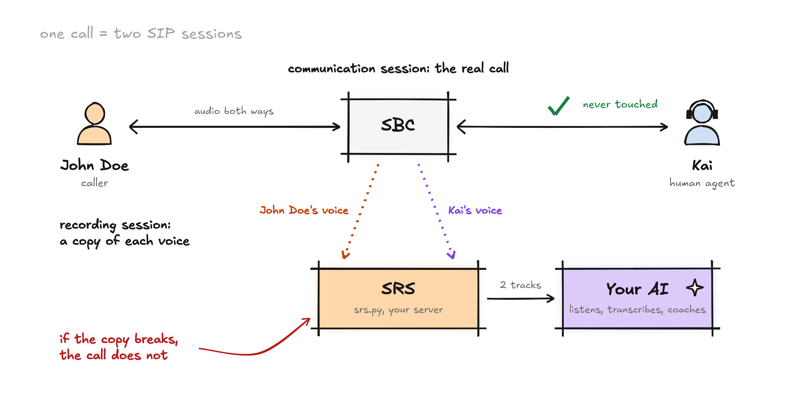

# siprec-livekit

Your SBC sends a copy of each voice on a call (SIPREC). This server receives it and puts each speaker into a LiveKit room as their own audio track, so an AI agent can listen without touching the real call.



## Run

```bash
pip install -e .

export LIVEKIT_URL=wss://your-project.livekit.cloud
export LIVEKIT_API_KEY=...
export LIVEKIT_API_SECRET=...
export PUBLIC_IP=1.2.3.4   # the IP your SBC can reach

python srs.py
```

Point your SBC's SIPREC recorder at `udp/5060`. Each call shows up as room `siprec-<call id>` with one track per speaker.

## Try it without an SBC

```bash
livekit-server --dev
python srs.py
pip install -e ".[test]"
python tests/listener.py siprec-call42sbc 10
python tests/fake_sbc.py 8
```

The fake SBC plays a 440 Hz tone as John Doe and 880 Hz as Kai. The listener should print:

```text
track 'John Doe': 6.1s audio, rms 6283, peak at 440 Hz
track 'Kai': 6.1s audio, rms 6266, peak at 880 Hz
```

## Note

This is a small teaching example (UDP, G.711, no jitter buffer, no auth). The full write-up, including what breaks in production, is on [mahimai.ca](https://mahimai.ca/blog).

MIT licensed.
